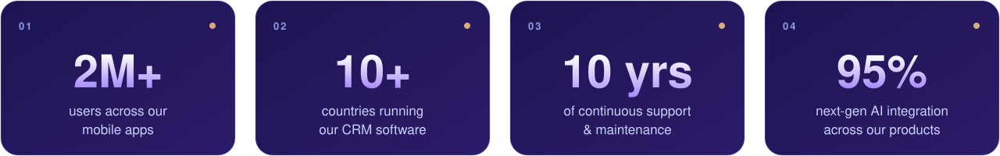
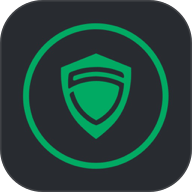
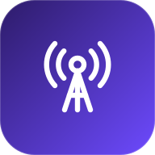

## About us

At **Sigma Software** we harness modern technology to craft visionary software and applications. Our multicultural, multidisciplinary team works across design, engineering and marketing to deliver custom-made solutions for each client — from AI integration and mobile apps to CRM, automation and cloud platforms — and we stay with our clients long after launch.

  

## What we do

<table>
  <tr>
    <td width="33%" valign="top">
       
      <b>AI Development &amp; Integration</b> 
      Machine learning, NLP and automation tools that sharpen decisions and streamline processes.
    </td>
    <td width="33%" valign="top">
       
      <b>Mobile App Development</b> 
      High-performance, user-friendly apps for iOS and Android, built around your business goals.
    </td>
    <td width="33%" valign="top">
       
      <b>Web Application Development</b> 
      Fast, secure and scalable web platforms — from customer portals to internal tools.
    </td>
  </tr>
  <tr>
    <td width="33%" valign="top">
       
      <b>Custom Software Development</b> 
      End-to-end solutions designed for your business, engineered for performance, scale and reliability.
    </td>
    <td width="33%" valign="top">
       
      <b>UI/UX Design</b> 
      Compelling experiences and elegant interfaces that lift satisfaction and engagement on every platform.
    </td>
    <td width="33%" valign="top">
       
      <b>Cloud-Based Solutions</b> 
      Secure, scalable and efficient cloud applications that grow with your business.
    </td>
  </tr>
  <tr>
    <td width="33%" valign="top">
       
      <b>Quality Assurance &amp; Testing</b> 
      Comprehensive testing for performance, security and functionality before anything ships.
    </td>
    <td width="33%" valign="top">
       
      <b>CRM &amp; Automation</b> 
      CRM and workflow automation that strengthen customer relationships and remove repetitive work.
    </td>
    <td width="33%" valign="top">
       
      <b>Maintenance &amp; Support</b> 
      Ongoing updates and 24/7 support that keep your software running smoothly and securely.
    </td>
  </tr>
</table>

## Our products

<table>
  <tr>
    <td width="33%" align="center" valign="top">
       
      <b>Quran Kuran</b> 
      Read, listen to and learn the Holy Quran word by word. 
      <a href="https://qurankuran.com/">Website</a> · <a href="https://apps.apple.com/us/app/quran-kuran-word-by-word/id1235040797">App Store</a>
    </td>
    <td width="33%" align="center" valign="top">
       
      <b>Sigma VPN</b> 
      Private, encrypted browsing through a secure virtual network. 
      <a href="https://www.sigmavpn.app/">Website</a> · <a href="https://apps.apple.com/us/app/sigma-vpn/id1524035161">App Store</a>
    </td>
    <td width="33%" align="center" valign="top">
       
      <b>Sosiro</b> 
      Friendships, events and services for people living abroad. 
      <a href="https://apps.apple.com/tr/app/sosiro/id1613179810">App Store</a>
    </td>
  </tr>
  <tr>
    <td width="33%" align="center" valign="top">
       
      <b>Jupap Messenger</b> 
      Fast, secure messaging and social networking. 
      <a href="https://www.jupapmessenger.com/">Website</a> · <a href="https://apps.apple.com/us/app/jupap-messenger/id1602219274">App Store</a>
    </td>
    <td width="33%" align="center" valign="top">
       
      <b>Cell Info</b> 
      GSM information map with advanced filtering and verified data. 
      <a href="mailto:info@cellinfo.com?subject=Get%20Demo">Request a demo</a>
    </td>
    <td width="33%" align="center" valign="middle">
      <a href="https://www.sigmasoftwares.com/blank"><b>Explore all apps →</b></a> 
      Security, fintech, social and more at sigmasoftwares.com
    </td>
  </tr>
</table>

## Open source

<table>
  <tr>
    <td>
      <a href="https://github.com/cellsigmasoftware/zoho-helper"><b>zoho-helper</b></a>
      &nbsp;
      
       
      A Node.js toolkit for Zoho APIs — OAuth token handling plus ready-made clients for Zoho People, CRM, Books and Qntrl (Orchestly). 
      <code>npm install @sigmasofttelecom/zoho-helper</code>
    </td>
  </tr>
</table>

## Technologies we work with

   
  

## Join the team

We're a multicultural team building products used in more than ten countries, and we're growing. Current openings:

**Software Developer** · **Python Developer** · **Software Architect** · **Full Stack Developer**

→ [See open roles and apply](https://www.sigmasoftwares.com/company)

## Let's work together

Tell us what you need — we'll build it.

- **Website:** [sigmasoftwares.com](https://www.sigmasoftwares.com)
- **Email:** [sigma.software@sigmatelecom.com](mailto:sigma.software@sigmatelecom.com)
- **Office:** 3866 Silverside Rd, Ste 105, Wilmington, DE 19809, USA

  
   
  Sigma Software is a Sigma Group brand.

